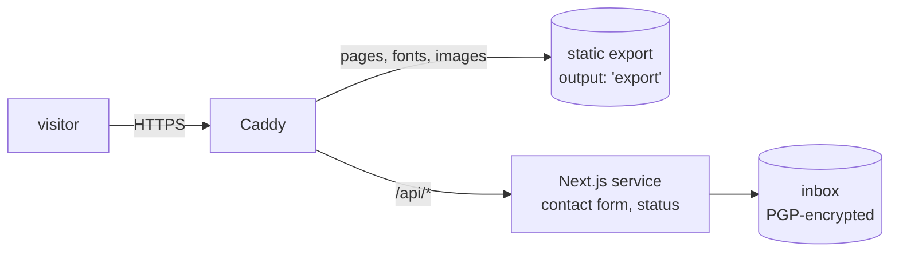

# sami-portfolio (djouhri.de)

Source of my personal portfolio and CV site, [djouhri.de](https://djouhri.de).
Built with Next.js and exported as plain files that Caddy serves directly. A
small Next.js service stays behind it for the contact form. The site is
bilingual, German and English.

## Two builds from one codebase
- **`npm run build`** produces the static site (`output: 'export'`). Every
  public page is a file. There is no Node process behind a page view.
- **`BAU=dienst npm run build`** produces the `standalone` service that answers
  `/api/*` only. This is what the `Dockerfile` builds.

Language detection, the redirect from `/` and the security headers live in the
Caddy config, because a static export cannot set headers itself.

## Contact form
- Self-contained proof-of-work captcha, no third-party widget
- Each message is encrypted with my public PGP key before it is stored. The
  private key is never on the server, so the inbox is decrypted in the browser
  on a machine I own

## Hardened service container
Read-only root filesystem, non-root user, all capabilities dropped,
`no-new-privileges`, memory limit with swap off.

## Structure
- `app/`: routes (App Router), API routes, CV renderer
- `lib/`: content (projects, case studies, CV), i18n dictionary
- `Dockerfile` and `docker-compose.yml`: the `/api` service

## Notes
The delivery script, the Caddy config generator and the quality gates have
been taken out, together with the host details they contain. A few code
comments still name those scripts. What remains is the application code. MIT
licensed.

## About this snapshot

Of all the repos here this is the one whose result you can simply go and look at.
[djouhri.de](https://djouhri.de) is this code, running. The publishing script
still strips the delivery path and the host configuration, rewrites internal
addresses to placeholders, and blocks the push unless two secret scanners agree.

The development history stays private, hence a public one that starts at the
first release.
